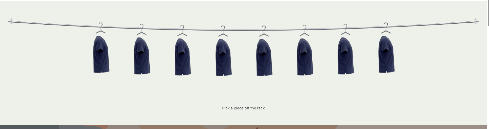

# Shopify Clothing Sections

Two interactive sections for Shopify's **Horizon** theme that hang a collection's products on a chrome rail, like garments in a real shop. Shoppers pull hangers along the rail, see each garment turn on hover, and lift a piece off the rack to pick a colour and size and add it to the cart, all without leaving the page.




Built by **Omar Sameh Elnabwey** for [Drs Lounge](https://drslounge.com), a Saudi medical-apparel brand.

---

## Contents

- [The sections](#the-sections)
- [Features](#features)
- [How it works](#how-it-works)
- [Install](#install)
- [Theme editor settings](#theme-editor-settings)
- [Requirements](#requirements)
- [File structure](#file-structure)

---

## The sections

### Clothing rack

Garments hang packed together on a chrome rail that sags into a gentle curve.

- **Pull the hangers:** drag hangers left and right. They push each other along, keep sliding with momentum and swing on their hooks.
- **Hover:** a garment turns to its second product image.
- **Click:** the garment lifts off the rack and flies to a centred quick view over a blurred page, with:
  - colour tags hanging beside the hanger (each one switches the image),
  - size pills for every other option,
  - price that follows the selected variant,
  - **Add to cart**, which updates Horizon's cart drawer and count,
  - a link to the full product page.

### Clothing rail

Garments hang on a curved rail that shoppers swipe or drag through.

- The garment in the centre comes forward and grows, with its title and price under the rail.
- A progress bar shows how far along the rail the shopper is.
- Optional side text and a link to the collection.
- Hover turns a garment to its second image.

---

## Features

| | Rack | Rail |
|---|:---:|:---:|
| Physics-based hanger movement (push, momentum, swing) | ✓ | |
| Swipe / drag to browse | ✓ | ✓ |
| Second image on hover | ✓ | ✓ |
| Quick view with variant picker and Add to cart | ✓ | |
| Adjustable rail curve | ✓ | ✓ |
| Automatic background removal for studio photos | ✓ | |
| Blend white photo backgrounds | | ✓ |
| Per-product cut-out image via metafield | ✓ | ✓ |
| Chrome or matching-colour rail finish | | ✓ |

**Accessibility and performance**

- The quick view is a native modal `<dialog>`: focus moves into it, **Esc** closes it, and focus returns to the garment on the rack.
- Every animation runs on transforms only (FLIP technique). With `prefers-reduced-motion`, the flight becomes a simple fade.
- Right-to-left layouts are supported.
- No libraries or external requests: plain JavaScript modules loaded through Horizon's import map.

---

## How it works

**Variant picker.** Colour options are shown as tags hanging next to the garment. Every other option (size, fit) becomes a row of pills. The variant that matches the selection drives the price, the image and the Add to cart button.

**Add to cart.** The request mirrors Horizon's own `product-form.js` and fires a `CartLinesUpdateEvent`, so the theme's cart drawer and count update as usual. The drawer opens once the quick view has closed.

**Background removal.** The quick view sits in the browser's top layer, where a white studio background would show as a box over the blurred page. The script flood-fills the plain background from the photo's edges, makes it transparent and feathers the garment's outline. Busy backgrounds and photos that are already cut-outs are left untouched, and results are cached per image for the life of the page.

**Cut-out images.** If a product has the `custom.rail_image` metafield, both sections use that image first, so merchants can upload a clean transparent cut-out for the rail.

---

## Install

### With Shopify CLI

Copy the `sections`, `assets` and `snippets` folders into your theme, then run:

```bash
shopify theme push \
  --only sections/clothing-ra* \
  --only assets/clothing-ra* \
  --only snippets/clothing-rail-hook.liquid
```

### From the Shopify admin

1. Go to **Online Store → Themes → … → Edit code**.
2. Create each file below with the same name, and paste in its contents:
   - **Sections:** `clothing-rack`, `clothing-rail`
   - **Assets:** `clothing-rack.js`, `clothing-rail.js`
   - **Snippets:** `clothing-rail-hook`
3. Open the theme editor and choose **Add section → Clothing rack** or **Clothing rail**.

### Optional: cut-out images

Create a product metafield definition **`custom.rail_image`** (type: *File → Image*) and upload a transparent PNG for any product that should hang more cleanly on the rail.

---

## Theme editor settings

### Clothing rack

| Setting | Default | What it does |
|---|---|---|
| Collection | | The collection to hang on the rack |
| Products to show | 12 | How many products to load |
| Heading | | Optional heading above the rack |
| Hint under the rack | *Pick a piece off the rack* | Short instruction under the rail |
| Show add to cart | On | Shows Add to cart in the quick view |
| Image to use | Featured | Which product image hangs on the rail |
| Trim photo top | 8 | Pulls the photo up so the hanger meets the collar |
| Turn to second image on hover | On | Swaps to the second image on hover |
| Remove plain photo backgrounds | On | Cuts studio backgrounds out in the quick view |
| Rail curve | 30 | How deep the rail sags (0 = straight) |
| Garment size | 100 | Size of each garment |
| Garment spacing | -40 | How tightly garments pack (negative overlaps) |
| Background colour, top and bottom padding | | Section spacing and colour |

### Clothing rail

| Setting | Default | What it does |
|---|---|---|
| Collection | | The collection to hang on the rail |
| Products to show | 10 | How many products to load |
| Heading | *Fresh off the rail* | Heading beside the rail |
| Side text | *Swipe the rail to browse…* | Short text beside the rail |
| Link label / Link | *Shop the collection* | Call to action under the rail |
| Image to use | Featured | Which product image hangs on the rail |
| Trim photo top | 8 | Pulls the photo up so the hanger meets the collar |
| Turn to second image on hover | On | Swaps to the second image on hover |
| Blend white photo backgrounds | On | Blends white studio backgrounds into the section |
| Rail and hanger finish | Chrome | Chrome, or a flat colour |
| Rail curve | 36 | How deep the rail curves |
| Garment size | 100 | Size of each garment |
| Garment spacing | -16 | How tightly garments pack |
| Centre garment size | 130 | How much the centred garment grows |
| Rail and hook colour | Theme foreground | Used with the flat-colour finish |
| Background colour, top and bottom padding | | Section spacing and colour |

---

## Requirements

- A theme based on **Shopify Horizon**. The scripts import `@theme/utilities` and `@shopify/events` from Horizon's import map, and the sections use its `spacing-style` and `contrast-override` snippets.
- Product photos shot on a plain background work best on the rail. Busy photos still work; they just keep their background.

---

## File structure

```
sections/
  clothing-rack.liquid      Rack markup, styles and settings
  clothing-rail.liquid      Rail markup, styles and settings
assets/
  clothing-rack.js          Hanger physics, quick view, variant picker, add to cart
  clothing-rail.js          Swipe and drag, centred garment, progress bar
snippets/
  clothing-rail-hook.liquid SVG hanger shared by both sections
docs/
  clothing-rack-preview.png Screenshot used in this README
```
